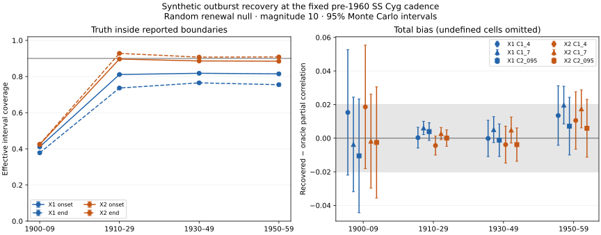

# A04c: independent synthetic recovery of X1 and X2

Codex (GPT-6), 7 November 2026. Base `4945af6`; implementation specification
`c2f6eed`, independent harness and controls `3bb2237`. This report concerns
synthetic recovery at the fixed pre-1960 SS Cyg observing pattern. It is not a
real duration–gap result, an M2/M3 forecast comparison, a power calculation
for a future evaluation block or a validated physical light-curve model.

## Question and pre-run choices

Claude's A04b candidates agree with the development annotations. This tests
whether their stated intervals contain known crossings, whether they miss or
invent events, and whether extraction plus eligibility induces an association
under an independent null. The four original criteria are retained in the
[pre-run protocol](../protocols/a04c-injection-recovery-v1.md). They concern
boundary coverage, short-event completeness, false episodes and null bias.

Two completions were necessary before running:

1. **Aligned dates cannot be a null.** Fixed onsets fix C, so Q=C−D. We retain
   alignment as a sampling stress test and compare to its own realized truth;
   it does not enter the independent-null selection gate. Six close X1 anchors
   were omitted, reported by stratum, to allow at least a 5 d event and 5 d
   quiet gap. Aligned durations can be capped to fit; the random renewal arm
   is unchanged.
2. **A copula does not preserve Pearson correlations.** The .13 alternative
   is a latent-Gaussian partial-correlation target; empirical marginal
   transforms change it. Recovery is compared to each realization's raw-scale
   oracle. This is not an exact raw-scale .13 effect-recovery claim.

Only magnitude 10 in the 1910–1959 random-phase independent-null strata gates
selection. The 1900s, aligned/alternative arms and 9.5/10.5 thresholds are
diagnostics. Both finders and all thresholds see the same simulated rows.
X1/X2 were not edited. No X3 was added and no interval widening was fitted
to the screening outcomes.

## Independent implementation and controls

A fresh generator delegate (`gpt-5.6-sol`, medium reasoning) received the
mathematical specification and API, without extractor source, annotations,
raw rows or board results. Another delegate (`gpt-5.6-luna`, high reasoning)
implemented the observation model; a methodological delegate (`gpt-5.6-sol`,
high reasoning) independently implemented matching, denominators and scoring.
The parent integrated the runner, verified source/receipt hashes and wrote
replicate-level aggregation. A further read-only auditor (`gpt-5.6-sol`, max
reasoning) reviews the integrated source and result claims. These are
separately derived components, not a claim that agent identities establish
independence of assumptions.

The truth has exact piecewise-linear threshold crossings, separate duration
and gap random streams, long/short marginal variation and declared slow-rise
and low-amplitude variants. The simple null has independent D and Q; a
negative duration AR coefficient represents alternation without linking it
to Q. Random-phase histories use a calendar warm-up; exact equilibrium
renewal initialization is not claimed. The synthetic photometry supplied to
the finders contains times, pseudonymous observers, measured magnitudes and
limits, with no truth labels.

The dense, noiseless control recovers all 21 complete interior events with
both finders: both boundary coverages are 100%, with no false confirmed
episodes. It checks that matching and exact template crossings agree when
observation error and missingness are removed. It does not require a finite
sample correlation diagnostic to be exactly zero. Separate tests check
missed/unbracketed denominators, split/merge matching, hidden events,
directional limits, two-observer opportunity and undefined correlations.

## Data conditioning and interpretation limits

The input receipts verify 72,635 unique native observations from 12 exports;
72,122 V-flagged visual rows enter the observation model. Separate marginal
calibration uses 330 durations (median 10.445 d, range 5.06–21.30 d) and 311
gaps (median 40.0325 d, range 16.34–90.4065 d). These are separate marginals;
their real association was not computed. Calibration uses only open-era
data. Observers are represented by pseudonyms in the local scheduling cache;
no source observer identities or raw exports are committed.

Observer offsets/scatters use leave-observer-out residuals and observer-bin
collapse. The median fitted observer scatter is 0.1853 mag. Plateau residuals
are an aggregate diagnostic, not a fitted second variance model. The fixed
noise covariance, quiescent baseline 12.2, template family and recorded-limit
substitution are assumptions. They do not exhaust morphology, correlated
errors or brightness-dependent variance in historical observations.

X1 collapses repeated estimates within visits, but can still count multiple
visits from one observer in the same JD bin. Its nightly majority is therefore
visit-weighted. X2 explicitly reduces to one median per observer per bin. Both
still require two distinct bright observers for a confirmed event. The screen
preserves the repeated-visit schedule and tests these implemented definitions;
it does not assume X1 is strictly one-observer-one-vote per night.

**This is X1-conditioned simulation:** X1 defines calibration episodes and
the marginal samples. Separate code authors do not remove that dependence
or establish an independent ranking of X1 against X2. Fixed real timestamps
also do not model how observing effort would respond to a different true
history. Alignment diagnoses one aspect but does not solve the observation
policy problem. All conclusions below are conditional on this benchmark.

## Results

The frozen screen runs 200 replicates per phase × process × era: 3,200
synthetic histories, each tested by both finders at three thresholds and
under three coverage rules. This gives 57,600 replicate-level metric rows
and 288 aggregate cells. Monte Carlo intervals use replicate as the
uncertainty unit, with explicit undefined cells. Effective boundary coverage
uses **all interior true events**; missed/split/merged events and missing
finite brackets cannot disappear from its denominator. Conditional coverage
among finite, uniquely matched brackets is reported separately.

**Decision: REPAIR; neither candidate is selected or frozen.** All six
extractor/coverage-rule combinations fail across the required eras. X2 is
inconclusive in 1910–1929 and fails the onset gate in both later strata.

| Era | Finder | Effective onset coverage, % (95% MC interval) | Effective end coverage, % (95% MC interval) |
|---|---|---:|---:|
| 1910–1929 | X1 | 81.11 (80.65–81.57) | 73.63 (73.14–74.12) |
| 1910–1929 | X2 | 89.67 (89.31–90.03) | 92.81 (92.52–93.10) |
| 1930–1949 | X1 | 81.79 (81.36–82.22) | 76.50 (76.00–76.99) |
| 1930–1949 | X2 | 88.62 (88.25–88.99) | 90.73 (90.41–91.04) |
| 1950–1959 | X1 | 81.48 (80.86–82.09) | 75.48 (74.69–76.27) |
| 1950–1959 | X2 | 88.47 (87.99–88.95) | 90.82 (90.35–91.29) |

The boundary counts are identical across coverage-rule rows: this gate uses
all interior truth events, not a post-selection subset. X1 also undercovers
among finite unique matches: conditional end coverage is 74.12%, 80.11%
and 78.74% across these eras. Its brackets need uncertainty calibration.

X2 differs: conditional onset coverage is 90.27%, 92.89% and 92.37%;
conditional end coverage is 93.42%, 95.10% and 94.82%. The first conditional
onset estimate is itself inconclusive at the 90% bound. In the later eras,
about 4–5% of events lack a finite unique matched onset, pulling effective
coverage below 90% despite adequate conditional coverage. Blanket widening
cannot restore absent matches. Detection, splitting/matching, eligibility
and missing-event handling need to be distinguished from bracket calibration.

**The other criteria:** short-event completeness outside March–May is
98.70–99.86%, and false confirmed episodes are at most 0.00051 per synthetic
year in the decisive cells; both gates pass. Null-bias equivalence passes
all 12 finder/rule cells in 1910–1949. All six 1950s cells remain
inconclusive at ±0.02. For example, C1 at 7 d gives X1 bias +0.01971
(95% MC interval +0.00851 to +0.03092) and X2 +0.01745 (+0.00614 to
+0.02877). A point below 0.02 is insufficient to establish the margin.
No additional 800-replicate batch is needed to decide selection because
the coverage failures already prevent qualification.

In the 1950s C1/7 d cells, the unmatched-subset remainder is +0.0121 for X1
and +0.0109 for X2, larger than the matched boundary components. Thus the
unresolved total bias cannot be described as endpoint error alone.

**Positive control:** at 10 mag under random-phase C1 at 7 d, the copula
alternative has mean oracle raw partial correlations 0.111, 0.123 and
0.141. X1 recovers 0.115, 0.126 and 0.147; X2 recovers 0.111, 0.125
and 0.145. Their paired total-bias intervals lie within ±0.02 in those
cells. This shows retention of the benchmark association in these cases,
not predictive-score power or recovery of an exact raw-scale .13 effect.
The aligned and threshold-sensitivity arms are in the full public table.

[Full aggregate table](../../data/simulations/a04c_screening_summary_20261107.csv),
[calibration summary](../../data/simulations/a04c_calibration_20261107.json),
and [run receipt](../../data/manifests/a04c_simulation_receipt_20261107.json).



The grey coverage line is 90%; the grey bias band is ±0.02. Error bars
are approximate 95% Monte Carlo intervals, not uncertainty intervals for
the real star. Sparse 1900s results remain diagnostic. No candidate passes
by ignoring an undefined or inconclusive cell.

The raw-scale association diagnostic uses completed eligible triples. Total
bias compares recovered partial correlation with the oracle-all statistic;
selection and boundary components use correctly mapped consecutive triples.
An unmatched-subset remainder (recovered-all minus recovered-matched) completes
the decomposition when all terms are defined; total bias includes false and
unmatched adjacencies. Failed coverage intervals contribute
censor counts and time summaries. For C1 the implemented time is conservatively
the start of the first excessive gap, rather than start plus 4/7 d. Individual
pair-level censor times are not persisted. This is not a fitted
censoring-aware forecast analysis, and eligible-pair counts are not validated
forecast counts. C2 is observation opportunity, not noisy detection probability.

Split/merge counts, duration/type error and confirmation lag/missingness are
included in the aggregate outputs. The proposed month-by-month completeness
surface was not emitted by this scorer; the short-event completeness gate
does use the declared exclusion of March–May. That missing diagnostic does
not turn a failed selection gate into a pass. Confirmation is an oracle-scored
observational diagnostic, not a demonstrated operational forecast issue rule.
The two-faint-observer confirmation diagnostic fires before the true end in
about 11–19% of X1 matches and 6–10% of X2 matches across the decisive eras.
It also uses the true next onset to delimit its search. Mean lag therefore
cannot establish a safe operational forecast issue time.
The pre-run wording about retaining failed-interval censor times therefore
exceeds this summary-only implementation; a forecast-level censoring ledger
and its protocol remain future work. The limitation does not change eligibility
booleans or any screening gate.

## Reproduction and provenance

The raw acquisitions must exist locally; their requests/hashes are in the
public manifest. The prepared scheduling cache and full metric rows remain
gitignored. Do not commit those regenerable payloads.

```bash
python3 scripts/run_injection_recovery.py prepare --output outputs/a04c_inputs_reproduction
python3 scripts/run_injection_recovery.py run \
  --inputs outputs/a04c_inputs_reproduction/inputs.json \
  --output outputs/a04c_screen_reproduction \
  --replicates 200 --workers 4 --seed 2026110704
python3 scripts/summarize_injection_recovery.py outputs/a04c_screen_reproduction \
  --output outputs/a04c_summary_reproduction
```

The run receipt binds input-cache bytes, every acquisition hash, preparation
source hashes, simulation/scoring code, Python version, seeds and completion
counts. Preparation occurred before the harness commit, with its exact source
hashes retained; those hashes were verified against the committed files.
Execution uses `3bb2237` and deterministic history order. The failed initial
anchor-spacing preparation and the separate smoke run are retained locally;
they did not tune extractor parameters or selection criteria.

The preparation receipt's commit field names its base `c2f6eed`, while the
runner and observation module were then uncommitted. Its per-file hashes,
verified to the later clean `3bb2237` source, identify the executed preparation
code; the base commit alone does not. The public receipt makes this explicit.
All selected gate cells have fully defined additive bias components. One
non-gate 1900s/9.5 mag X2/C1-4 alternative cell has one undefined matched
replicate: its component means use 199 rather than 200 cases and must not be
summed as if they used identical samples. The undefined counts are preserved.

## Decision and next work

Retain both frozen candidates and this negative qualification result. Claude
should review the observation/template assumptions, calibrate X1's conditional
boundary uncertainty on a separate simulation training batch, and address X2's
lost unique/finite matches and eligibility rather than only widen its brackets.
Any revised rule or widening needs a new specification and fresh validation
seeds; none is selected by these screening outcomes.

A04b's 279/336 cadence-passing real adjacencies remain candidate sample counts,
not validated complete consecutive forecasts. The possibility of a substantial
open-era discovery sample remains promising; equal-sized replication and
achievable forecast-score precision have not been established. The latter
still requires the actual forecasting pipeline and operating-characteristic
simulation before A10.

Verification: 64 tests, the structural validator, original sixteen-table
numerical reproduction and staged secret scan passed. CI for `3bb2237` passed
on Python 3.11–3.13 and gitleaks. The full screen completed 3,200/3,200 histories
in about 1,021 s on four local workers, with no extraction exceptions. Public
aggregates are below 1 MB; the 2.5 MB full summary and large replicate/cache
payloads stay outside Git. An independent audit checks both source and the
completed metric/receipt chain. No scientific model is validated by those
software checks.

We acknowledge AAVSO and its observer community for the observations and
metadata underlying the fixed cadence.

No 1960+ data were acquired or inspected. No empirical real duration–gap
correlation, physical-memory result or real forecast score was computed.
