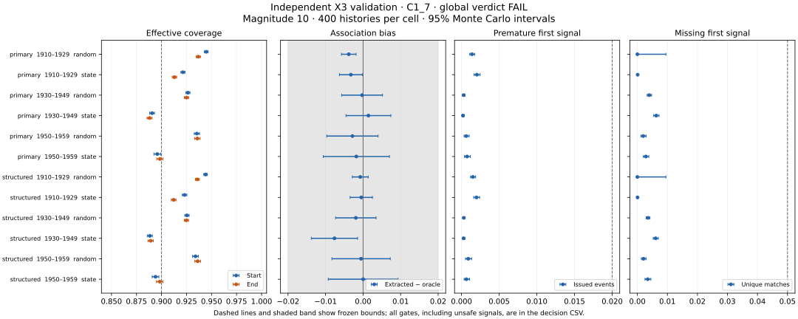

# A04e: independent X3 validation

Codex, 7–8 November 2026; base `66cfdf2`. Final pre-outcome freeze:
`2f7a7eca4ece7a7702fb429ec5bb4a94a2bc57d1`. X3 remains byte-identical to
Claude's `c0353c0` candidate. This is a synthetic extraction study, not a
real-star association or forecast-skill result.

## Scope and benchmark decision

I accept replacing the original A04c waveform as the primary benchmark. It
has a special decline knot at magnitude 10 and couples decline speed to
duration; it does not reproduce the selected open-era morphology summaries.
That decision precedes new candidate-validation outcomes. The original
waveform and original observation model remain a separately reported
misspecification challenge, including any reproduced X3 failure. Passing the
replacement cannot retrospectively turn that failure into a pass.

The new truth author received neither X3 source, Claude's training generator,
annotations nor raw photometry. The independent construction uses asymmetric
half-Gaussian flanks and flat peaks, preserving the existing random duration
and gap streams at magnitude 10. It has curved crossings without a special
threshold knot. Rise and decline slopes are drawn independently of duration;
amplitude is reduced when the requested flanks cannot fit the duration. This
is one finite family, not a physical accretion-disc model.

Parent-owned observation work uses only the already opened pre-1960 stream.
The same Theil–Sen measurement operator is applied to real and simulated
rows; real targets remain conditioned on X1 selection and finite positive
fits. Correct average ranks for tied values change the real slope–duration
Spearman summary from 0.044 to 0.045. This is an end-slope diagnostic, not a
duration–following-gap calculation.

I recalibrated observer residuals at outburst brightness rather than using
only the old quiet-star model. The state-compatible cadence arm retains all
original empty days and borrows observed-day visit patterns from a nearby
same-state donor. It is a truth-conditioned stress test within an observed-day
skeleton, not an identified model of observers deciding when to look.

## Calibration, freezing and qualification

The [frozen protocol](../protocols/a04e-x3-independent-validation-v1.md)
specifies separate calibration, morphology-qualification and recovery seed
namespaces. All 36 finite calibration attempts are preserved in the
[public calibration record](../../data/simulations/a04e_morphology_calibration_20261107.json).
The verified calibration rerun reproduced every attempt byte-for-byte.

The selected shape has median rise 0.95 and decline 0.40 mag/day, decline
log-SD 0.20 and noise multiplier 0.95; it is configuration 24 in zero-based
grid order. No recovery score entered that selection. Observed residual
scatter combines curvature, sampling and measurement noise; it is not a
direct estimate of a single latent noise parameter.

Initial source/configuration freeze `3ad0939` passed fresh morphology
qualification. Before any candidate-validation outcomes, independent audit
required counting ambiguous causal emissions as unsafe and binding the
decision script to the freeze, with a final runtime rehash. Freeze `2f7a7ec`
incorporates those changes. Both the earlier qualification and the mandatory
new-hash qualification are retained; neither selected a new generator or
parameter configuration. A separate CI-only commit fetches full Git history
so candidate-source provenance can be checked in CI.

The final qualification uses twelve histories per era and cadence phase,
pooled within phase. All seven prespecified morphology checks pass:

| Measured feature | Real | Random cadence | State-compatible cadence |
|---|---:|---:|---:|
| Median rise speed, mag/day | 0.667 | 0.690 | 0.667 |
| Median end speed, mag/day | 0.333 | 0.334 | 0.333 |
| Median end residual SD, mag | 0.222 | 0.216 | 0.222 |
| End-speed–duration Spearman | 0.045 | 0.031 | 0.052 |
| Below/above end-speed ratio | 0.985 | 0.942 | 0.951 |
| Above-threshold positive-fit fraction | 0.833 | 0.772 | 0.804 |
| Below-threshold positive-fit fraction | 0.782 | 0.702 | 0.712 |

The state-compatible donor no-match fraction is 0.0518, below the frozen
0.10 limit. Matching these selected targets does not establish exhaustive
light-curve realism or remove informative missingness.

## Confirmation times and information sets

X3's final `confirmed` field is retrospective. In a fixed synthetic witness,
a prefix confirms an event at relative day 104.7, while the final catalogue
moves confirmation to day 108.7 after a later bright tail. The
[public witness](../../data/simulations/a04e_prefix_witness_20261107.json)
preserves this counterexample. Final-catalogue confirmation cannot be used as
an unqualified claim about the first signal an observer would have received.

The separately specified causal wrapper arms after two distinct bright
observers and permanently emits at the first two sufficiently faint
observers. A visit becomes available at its closing time, not its median
observation time. Equal-time visits are processed atomically; a bright vote
suppresses simultaneous faint confirmation. Strong faint evidence also
clears an unarmed one-observer provisional episode. False and ambiguous
emissions both count against the safety criterion. None can be erased by a
later merge.

This tests emission behaviour only. It does not show that final X3 endpoints,
duration estimates or all predictor features were available at emission.
Prefix-causal feature construction and historical reporting latency remain
A10 work. Positive-control association recovery is diagnostic here; a
prespecified predictive recovery and power gate is still required before A10.

## Validation results

**X3 fails the frozen qualification under both global coverage rules. No
extractor is selected.** The complete run contains 7,600 histories, 79,200
metric rows and 324 aggregate cells, with no extraction exceptions. Runtime
sources match the freeze before and after execution. The run completed in
4,781 seconds using four local workers.
Execution used Python 3.15.0 on macOS/arm64; the completed local receipt
preserves the full Python/platform strings, input hashes and source identities.

The decisive C1/7 d results below use 400 histories per row. Percentages are
effective coverage: missed, non-unique and nonfinite boundaries remain in the
denominator. `Bias` is the mean paired extracted-minus-realized-oracle partial
correlation. The [decision table](../../data/simulations/a04e_validation_20261108/public_decision.csv)
contains every gate estimate, interval and verdict for both rules.

| Control | Era | Cadence | Start % | End % | Bias | Cell verdict |
|---|---|---|---:|---:|---:|---|
| Independent | 1910–1929 | Original | 94.47 | 93.68 | −0.0038 | Inconclusive |
| Independent | 1910–1929 | State-compatible | 92.15 | 91.30 | −0.0033 | Inconclusive |
| Independent | 1930–1949 | Original | 92.64 | 92.50 | −0.0003 | Pass |
| Independent | 1930–1949 | State-compatible | 89.06 | 88.80 | +0.0014 | Fail |
| Independent | 1950–1959 | Original | 93.54 | 93.58 | −0.0028 | Pass |
| Independent | 1950–1959 | State-compatible | 89.58 | 89.84 | −0.0018 | Fail |
| Structured zero-mark | 1910–1929 | Original | 94.40 | 93.58 | −0.0008 | Inconclusive |
| Structured zero-mark | 1910–1929 | State-compatible | 92.31 | 91.22 | −0.0005 | Inconclusive |
| Structured zero-mark | 1930–1949 | Original | 92.55 | 92.49 | −0.0019 | Pass |
| Structured zero-mark | 1930–1949 | State-compatible | 88.83 | 88.92 | −0.0076 | Fail |
| Structured zero-mark | 1950–1959 | Original | 93.40 | 93.62 | −0.0005 | Pass |
| Structured zero-mark | 1950–1959 | State-compatible | 89.40 | 89.82 | +0.0000 | Fail |

For independent-control 1930–1949 state cadence, start coverage is
89.06% [88.82, 89.30] and end coverage 88.80% [88.55, 89.06]; both entire
95% Monte Carlo intervals fall below 90%. The structured control repeats
that failure. The 1950s state-cadence start also fails in both controls;
end coverage there is inconclusive. These coverage measures do not change
between C1 and C2, so switching rules cannot rescue qualification.

Conditional boundary coverage is substantially better: 93.44–95.85% across
the decisive X3 boundaries. In the poorer state-cadence cells, fewer events
have unique usable matches, lowering effective coverage to about 89%.
Both matching loss and finite-interval misses contribute; matching loss is
slightly larger in the failing cells. Conditional coverage cannot be
described as overall success.

Other criteria are informative even though the global result fails:

- C1 paired null-bias intervals all lie inside ±0.02, including the 1950s.
  The old screen's inconclusive bias result is resolved for this new
  conditional benchmark and rule. C2 still has two inconclusive bias cells.
- Short-event completeness outside March–May and retrospective false-event
  rates clear their bounds in all twelve decisive cells.
- First-emission premature rates are 0.020–0.205%, with every upper interval
  bound below 0.25%, against the 2% criterion. Missing rates also clear 5%.
  This is the new causal wrapper, not validation of X3's retrospective
  confirmation field as a first-signal policy.
- The 1910–1929 causal unsafe rate is 0.192–0.198/year. Each interval crosses
  0.2/year, so all four corresponding cells are inconclusive. Pure false
  signals dominate there; ambiguous assignments matter more in the later
  eras. The final catalogue's much lower false-event rate cannot replace
  this causal check.



## Preserved challenges and positive control

On original-v1 morphology and observation noise, X3 end coverage is
84.24–86.24%. The old failure is reproduced. With additional persistent
observer offsets, end coverage is 89.33–90.54%; the 1930–1949 end interval
fails 90%. These remain reported diagnostics, not retroactive primary gates.
The 1900s diagnostic has only about 41–45% effective coverage, consistent
with retaining that sparse era outside the decisive envelope.

The positive-control latent partial effect is 0.13; its realized raw-scale
oracle means are 0.118–0.129. X3/C1 recovers 0.114–0.123, with paired biases
between −0.0072 and −0.0013 across the six magnitude-10 cells. Thus this
association summary largely retains the injected signal under the tested
family. It is not a forecast-score recovery experiment, an empirical effect
estimate or a power calculation. All reference-extractor, threshold and
stress-arm summaries are in the [324-cell diagnostic table](../../data/simulations/a04e_validation_20261108/public_diagnostics.csv).

X1/X2 still under-cover on the new decisive benchmark: effective end
coverage ranges are 66.6–69.0% and 69.9–77.7%, respectively, compared with
X3's 88.8–93.7%. X3 is a clear improvement without meeting the global gate.

## Consequence and remaining limits

Do not freeze X3 for A10, open reserved data or compute the real duration–gap
association on the strength of this run. The highest-value next step is
Claude's review of the state-cadence detection losses and causal false signals,
including whether the assumed amplitude tails and observing policy adequately
represent the intended application. Simply widening boundary intervals does
not recover a missing event. A revised eligibility or missed-event model
needs a stated estimand and fresh validation, preserving this failed version.

This benchmark qualifies only selected morphology summaries. In particular,
the fixed 5% low-amplitude tail, more complex real pulse shapes, observation
initiation on missing days, observer-systematics misspecification and upload
latency remain unvalidated. Duplicate causal emissions are retained in the
ledger but not added to the frozen false-plus-ambiguous gate; a forecast
pipeline must specify how it handles them. The synthetic partial-correlation
screen is not a censoring-aware forecast likelihood.

## Independent review and verification

A separate read-only auditor independently reaggregated every one of the
24 decisive X3 cells from metric rows and obtained identical estimates,
intervals and verdicts. It verified the completed metric and 15,200-record
ledger hashes, reconciled all 4,800 primary ledger records against their
metric keys, and found zero count discrepancies for emissions, matching,
missing/premature confirmations and eligible pairs. All 28,512 diagnostic
table values and every decision-table interval/verdict match their sources.

The independent primary 1930–1949 state-cadence onset decomposition is
3,406 unmatched events, 137 non-unique matches and 2,461 finite intervals
missing the truth. Both detection/matching and boundary uncertainty need
attention. Across primary C1 histories, the causal ledger contains 4,514
false, 410 ambiguous and 136 duplicate extra emissions. Duplicate rates are
low (at most 0.0084/year), but require an explicit truth-free policy at A10.

Local verification passed all 120 tests, the seed structural validator,
visual inspection of both rule figures, and the staged secret scan. The
frozen source also passed CI on Python 3.11–3.13. These checks support the
integrity of this failed synthetic screen; they do not validate a real-star
forecast model.

## Reproduction and provenance

The private prepared cache is SHA-256
`89825f1b6c92f53713fc800e4be1668ba96200b35f2c44c1ee650bf806f2a5fb`.
It is bound to all twelve native acquisition identities, the accepted A04c
cache, preparation receipt and all calibration-attempt hashes through
[`configs/a04e_inputs.json`](../../configs/a04e_inputs.json).
Raw observations, observer metadata and full regenerable outputs stay
outside Git.

```bash
python3 scripts/run_x3_validation.py \
  --inputs outputs/a04e_inputs_verified_20261107/inputs.json \
  --parameters configs/a04e_benchmark.json \
  --qualification outputs/a04e_qualification_final_20261107/receipt.json \
  --freeze-commit 2f7a7eca4ece7a7702fb429ec5bb4a94a2bc57d1 \
  --output outputs/a04e_validation_20261107 --workers 4
python3 scripts/summarize_x3_validation.py \
  outputs/a04e_validation_20261107 --output outputs/a04e_summary_20261107
python3 scripts/publish_x3_validation.py outputs/a04e_summary_20261107 \
  --receipt outputs/a04e_validation_20261107/receipt.json \
  --output data/simulations/a04e_validation_20261108
```

Use fresh output directories; nothing overwrites an earlier run. The seed
namespace comes from the frozen commit, not a later reporting commit. The
runner checks source identity before and after execution. The authoritative
decision object is `fullsummary.json`; its compact diagnostic CSV omits the
unsafe-emission field and is not the reviewed decision table.
The public manifest binds the reviewed tables to the completed metric and
ledger hashes. These commands require the retained local input cache;
a fresh public clone alone does not contain the third-party exports or
observer-level calibration inputs.

No 1960+ photometry or reserved-block coverage has been opened, and no real
duration–following-gap correlation has been computed in this tranche.
