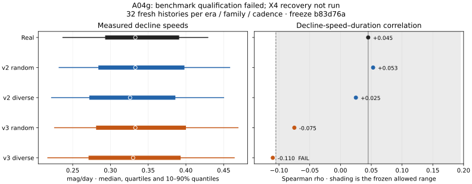

# A04g independent X4 validation

Codex, 8 November 2026, base `4816f89`. X4 remains byte-identical to Claude's
`352a09e` candidate. This tranche completes and amends the proposed A04g
protocol, constructs an independently authored waveform and observation
condition, qualifies the benchmark, then tests recovery only if qualification
passes. No real duration–following-gap association or reserved data are used.

## Review of A04f

The repeated-donor diagnosis is sound: the A04e state condition can copy the
same observer cast across a synthetic outburst. It should remain a reported
stress rather than be described as an empirically calibrated observer process.
That does not erase X3's frozen failure, which also includes finite-interval
misses and causal false signals.

The 0.05-mag floor is an empirical calibration safeguard. X3's 99% posterior
level was chosen to produce approximately 95% empirical coverage, so its
remaining misses do not identify shared error as the sole cause. Curvature,
clipping and slope-prior misspecification remain alternatives. The X4 source
implements the stated floor, single-observer retrospective confirmation and
strong-bright causal arming. Persistent wrong reports remain a risk to test.

The proposed 15% observer-median gate would reject Claude's own 1930–1949
random result (13 against 16). I retain that tolerance for repaired diverse
arms and keep random as an explicitly diversity-misspecified **mandatory
robustness veto**. It is not called diversity-qualified. This amendment
precedes new qualification/recovery outcomes and does not relax recovery
criteria or remove an inconvenient candidate failure.

## Independent construction and retained failures

The waveform author saw the original timing API and parameter names, but
neither X4/X3 source, v2 source, Claude's training generator, annotations nor
raw observations. After initial implementation, a full test run exposed
other test names/pass statuses. Subsequent waveform repair remained blind
to candidate source and recovery results; the limited exposure is disclosed.

The initial half-cosine family (`c9d51b8`) preserved timing but steepened
short-event flanks to fit fixed amplitude. A six-history morphology-only
pilot found slope–duration rho −0.399 versus real +0.045. The
[initial pilot](../../data/simulations/a04g_v3_initial_morphology_20261108.json)
and source are retained. The repair (`75f90e4`, `7212934`) uses a global
monotone polynomial mixture, adapting curvature while preserving D/Q,
reference tangent slopes and peak amplitudes. It has no threshold join but
does use a reference-centred curvature basis. It is a constrained test family,
not a physical model of real outburst shapes.

A separate author built cadence without X4 source or development results.
The first rotating-donor design (`ef34d42`) fixed median cast size but
underrepresented low-observer events. A whole-event bootstrap (`95fd7d2`)
restored that tail, but added 6.3% empty days and failed morphology and the
1930–1949 median. Both failed versions and their pilot summaries are retained.
The final design matches donor blocks by calendar span, season and epoch,
without matching observer count, target observation count or a following gap.
It preserves original empty days and explicitly records additional donor-
missing days. These are never quiescent measurements. The bounded v2 pilot
passes all gates, adding approximately 2.1% empty days.

The independent causal implementation was source-hashed before reference
inspection and agrees exactly with X4 on adversarial fixtures and 500 finite
fuzz histories. Its
[pre-exposure bytes](../../data/provenance/a04g_x4_causal_preexposure.py.txt)
match the acknowledged hash; they were reconstructed after exposure, so the
repository does not provide an independently timestamped pre-exposure commit.
Every recovery history requires ledger concordance before any recovery score.

## Finite morphology calibration and prospective qualification

Calibration source is preserved at
`28741bc8b6c27ad15450f14a0a969d88ef1f4aa2`. The predeclared 27-configuration
grid used two histories per era/phase, no X4 recovery scores. All attempts
are retained and hash-bound. Exactly one configuration passed both cadence
phases, so the deterministic choice is index 23: v3 rise median 1.1,
decline median 0.40 and noise multiplier 1.10. V2 parameters remain unchanged.
The [public calibration summary](../../data/simulations/a04g_morphology_calibration_20261108.json)
records all attempts rather than only the winner.

The selected v3 calibration rho is −0.084 in random cadence and −0.099 in
diverse cadence, near the allowed lower boundary −0.105. Fresh qualification
is essential. Before any fresh qualification, its size is fixed at 32
histories per era/phase/family to improve precision for low-diversity episodes.
No tolerance widening or after-failure seed extension is permitted.

Independent design audit found and integration corrected incompatible
qualification-receipt fields and an impossible requirement that the earlier
calibration-source commit equal the later final freeze. A producer-shaped
acceptance/rejection regression now checks that contract. Decision code,
candidate, inputs and every calibration attempt are bound to source/hash
records; runtime bytes are checked again after execution.

## Fresh qualification result: benchmark not qualified

The final source freeze is
`b83d76a6eb43b5145f72cbcfaad32fac2678e11b`. Fresh qualification completed all
384 histories (32 per era/family/phase). **V3 fails one frozen morphology
check in diverse cadence. X4 recovery was not run, so there is no independent
X4 recovery verdict.** The planned 16,600-history recovery grid was not
executed and its validation namespace remains unused.

The [public qualification record](../../data/simulations/a04g_qualification_20261108.json)
retains every check, nearby-threshold summary, per-era diversity result and
full-receipt/attempt hashes. No tolerance or seed extension followed failure.

| Measured feature | Real | v2 random | v2 diverse | v3 random | v3 diverse |
|---|---:|---:|---:|---:|---:|
| Median rise speed, mag/day | 0.667 | 0.673 | 0.697 | 0.732 | 0.750 |
| Median end speed, mag/day | 0.333 | 0.333 | 0.326 | 0.333 | 0.330 |
| Median end residual SD, mag | 0.222 | 0.219 | 0.219 | 0.241 | 0.236 |
| End-speed–duration Spearman | +0.045 | +0.053 | +0.025 | −0.075 | **−0.110** |
| Morphology gates | — | Pass | Pass | Pass | **Fail** |

The permitted rho difference is 0.15: the lower bound is −0.105. V3 diverse
has absolute difference 0.155, missing that boundary by 0.005. Its other six
morphology checks pass. This is a narrow failed gate, not proof of a large
physical discrepancy and not a reason to round the result into a pass.
The independent auditor recommended preserving the failure with X4 untested.



Both repaired diverse arms pass the unchanged observer gates in every era:

| Era | Real median / share ≤2 | v2 diverse | v3 diverse |
|---|---|---|---|
| 1910–1929 | 14.5 / 2.11% | 15 / 1.73% | 15 / 1.64% |
| 1930–1949 | 16 / 10.08% | 16 / 8.80% | 15 / 9.33% |
| 1950–1959 | 14 / 11.84% | 13 / 8.50% | 14 / 8.49% |

No donor fallback occurs in these batches. Additional donor-derived missing
days are 1.72–2.25% of originally observed days, depending on family/era;
they remain missing. The random arms reproduce the known 1930–1949 median
mismatch and are not diversity-qualified, as specified before qualification.

### Why I did not widen the grid or rerun seeds

The measured end-slope distribution already has more spread in v3 than real:

| Quantile | Real | v3 random | v3 diverse |
|---|---:|---:|---:|
| 10% | 0.237 | 0.226 | 0.217 |
| 25% | 0.293 | 0.281 | 0.271 |
| 50% | 0.333 | 0.333 | 0.330 |
| 75% | 0.391 | 0.400 | 0.393 |
| 90% | 0.429 | 0.469 | 0.464 |

Increasing intrinsic decline spread merely to attenuate rho is not justified
by that evidence. The diagnostic short/long medians are 0.333/0.341 in real
data and 0.335/0.317 in v3 diverse cadence (the morphology diagnostic splits
at 11 d). This shows residual dependence in the simulated measured features;
it does not isolate waveform geometry from selection/cadence as the sole
cause. V3 adapts curvature for approximately 39% of generated events while
preserving tangent slopes, peaks and D/Q. Future work should test a separately
versioned joint morphology design with prespecified distributional targets,
not search spread parameters or random seeds for an acceptable rho.

The recovery runner independently rejects this actual failed receipt with
`qualification did not pass` before creating an output directory or scoring
a candidate. No candidate widening, repair or label access followed it.

## Scope and reproduction

The [completed protocol](../protocols/a04g-x4-independent-validation-v1.md)
prespecifies 16,600 histories, 51,800 metric rows and 33,200 X4 magnitude-10
ledger records. Two waveform families, two controls, three eras and both
cadences give 24 ordinary decisive cells per global rule; six gross-error
cells additionally gate only the false-signal criteria. References are on a
fixed subset to avoid repeating the expensive full grid.

Gross contamination uses a 0.32% quiet observer-night budget with 1–3-night
persistence included in that budget. This is a fivefold bright-visit-proxy
stress intensity, not an identified wrong-star probability. The original
unexplained bright reports were not labelled archive mistakes.

Prepared inputs are SHA-256
`572f24f553c7be443c888483ede4c50c67979b05ce75901eeb0470512fa72811`,
bound to the unchanged A04e cache, its twelve native acquisitions and the
independently reproduced real diversity targets. Full outputs and
observer-level calibration inputs remain ignored. A fresh public clone alone
does not redistribute them.

An extraction pass would still be conditional synthetic evidence. It would
not establish real forecast skill, physical memory, operational reporting
latency or predictor availability at emission. A10 remains unfrozen; 1960+
photometry/reserved coverage remain closed.

## Reproduction, checks and next tranche

```bash
python3 scripts/calibrate_x4_benchmark.py qualify \
  --inputs outputs/a04g_inputs_20261108/inputs.json \
  --parameters configs/a04g_benchmark.json \
  --calibration outputs/a04g_calibration_20261108/receipt.json \
  --freeze-commit b83d76a6eb43b5145f72cbcfaad32fac2678e11b \
  --output outputs/a04g_qualification_20261108 --workers 4
```

The failed directory is immutable; use a fresh destination to reproduce.
Qualification requires the clean freeze at HEAD. The source commits,
calibration recipe and configuration/receipt hashes identify the historical
execution. Local checks passed 166 tests, seed structural validation and the
staged secret scan. CI at the freeze passed on Python 3.11–3.13. Independent
review verified source/input/calibration bindings, the causal implementation,
receipt contracts and the scientific stop decision. A passing test suite
does not override the failed morphology gate.

Final independent receipt review checked all fourteen recorded benchmark
source hashes against the freeze and verified the public record's source-file
hashes and exact morphology/diversity fields. The parent also checked all
nineteen declared recovery runtime files remain byte-identical to the freeze.
The unused recovery output directory does not exist. These checks confirm
the recorded qualification failure, not X4 recovery performance.

Next: Claude reviews the retained qualification failure and proposes a fresh
joint morphology specification, keeping X4 unchanged. Independent X4 recovery
remains outstanding; the observer-diversity repair can be reused subject to
fresh qualification in that version. No real D–Q result, A05 extraction
catalogue or A10 protocol has been produced here.
