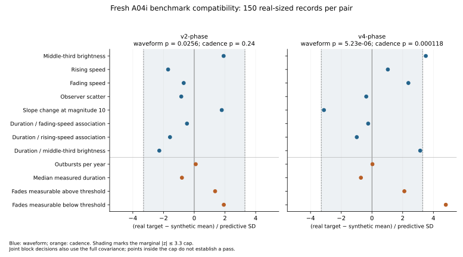

# A04i: joint benchmark qualification and unchanged-X4 recovery

Codex, 8 November 2026. Source `036c619`; evaluation freeze
`939ea778c2eab578dcc4fa22a1e0bf1903fbeefe`. D017 governs this version.

## Result

**Unchanged X4 passes the predeclared magnitude-10 retrospective recovery
screen on the sole qualified v2-phase pair under both global rules. C1/7 d
is selected by the frozen preference.** All six ordinary and three gross-error
cells pass under each rule. This is a conditional extraction result, not a
real-star forecast result or validation across an unseen waveform family.
Magnitude-9.5 diagnostics fail in the later eras and remain reported below.

Only **v2 with phase-aligned cadence** qualified for X4 recovery. The new
source-blind waveform failed before candidate scoring. A successful recovery
result here would therefore concern a waveform family Claude had already
studied, with independently constructed cadence and fresh validation seeds.
It would not establish robustness across an unseen waveform family.

## What was fixed before running

Cadence is a hard gate alongside waveform compatibility and observer diversity.
Undersampling a fading phase is not demonstrably conservative for fitted
crossing intervals whose width changes with density. Each selected pair is
assessed separately; failed pairs are dropped before candidate recovery, and
no eligible pair may be dropped after seeing X4 outcomes.

The real and synthetic measurement operators now use the same half-open era
cuts before pooling: 141/123/70 = **334 feature episodes**. This corrects the
previous full-stream/era-sliced mismatch; A04h's original 335 record remains
preserved. Measured middle-third brightness is not a direct true peak or a
physical mass estimate. V3's noiseless failure showed an intrinsic geometry
contribution, without excluding cadence or selection contributions.

The eight waveform and four cadence features use a blockwise normal-reference
prediction screen: p >=0.01 and every raw |z| <=3.3. Invalid vectors or covariance
cannot pass. The scaling is for a new real-sized vector, not uncertainty in a
synthetic mean. There is no asserted overall 1% rejection rate across blocks,
marginal caps and calibrated parameters, nor a guarantee of physical realism.

## Independent construction and one calibration round

A source-blind author built a rounded-power asymmetric waveform with
duration–amplitude coupling. It received timing interfaces and separated
open-era duration/gap marginals, without X4/X3, earlier waveform source,
annotations, real photometry or recovery labels. A separate source-blind
author built phase profiles from the twelve already opened native exports.
Its later full-test run exposed test names/statuses; this limited exposure is
disclosed rather than treating an agent identity as proof of independence.

The phase schedule transfers anonymous observer visits through quiet/rise/
core/decline/quiet anchors. Donor choice uses epoch, season, duration and
within-event geometry, never observer counts or a following gap. Original
empty native-JD days remain empty. This is a truth-conditioned generative
observation model, not a replay of historical upload availability.

Profiles exist for 398 of 439 full-stream X1 episodes: 65/86 before 1910,
142/143 in 1910–1929, 118/133 in 1930–1949 and 73/77 in 1950–1959. Sparse
episodes lacking anchors are a selection limitation. Both diversity and
end-sampling gates test its consequences. Calendar masking drops about
6–11% of borrowed visits in calibration; this diagnostic does not isolate
the cause of remaining shape or sampling discrepancies.

One finite ten-configuration grid used 16 pooled real-sized vectors per
setting (480 era histories). The phase policy, noise multiplier and rate
spreads were fixed. Selection minimized mean discrepancy in pre-existing
fixed v2-random SD units, without searching covariance or dispersion.
Every setting and raw feature vector is retained in
[`a04i_calibration_20261108.json`](../../data/simulations/a04i_calibration_20261108.json).
The winners were unchanged v2-00 (objective 31.9396) and v4-05 (62.0925).
These objective values are not predictive p-values or X4 scores.

Source, selected configurations, input/preparation hashes and every calibration
attempt were committed and pushed before qualification. Clean-source
preparation asserts exact source hashes, era bounds, feature counts and
profile totals. Qualification hashes all raw replicate attempts; recovery
recomputes every selected pair's eligibility rather than trusting flags.
The summarizer requires the exact runtime source set and parses the complete
two-rule history/seed ledger. Independent review identified and confirmed
these evidence-contract repairs before calibration.

## Fresh qualification

Each selected pair received 150 new pooled real-sized records, totalling
900 era histories. All 300 records were valid. The frozen namespace is
`a04i-qualification|939ea778c2eab578dcc4fa22a1e0bf1903fbeefe`.

| Pair | Waveform p; maximum absolute z | Cadence p; maximum absolute z | Diversity | Eligible |
|---|---:|---:|---|---|
| v2-phase | 0.0256016; 2.2752 | 0.239641; 1.9259 | All three pass | Yes |
| v4-phase | 0.00000523061; 3.5057 | 0.000117506; 4.8097 | All three pass | No |

The new waveform's middle-third brightness is 8.614 versus the real 8.682
(3.51 predictive SDs). Its fraction of fades measurable below the threshold
is 0.686 versus 0.784 (4.81 SDs). V2 reaches 0.742, 1.93 SDs below the target;
passing compatibility does not imply exact equality. Its waveform p is above
but fairly near the 0.01 boundary. No second tuning grid, seed extension or
tolerance change followed either outcome.

An independent R audit used colMeans/cov/solve/pf on the raw vectors, pooled
the observer-count arrays independently, and reconciled input/source/attempt
hashes. It reproduced both pair decisions and all ten calibration objectives
(to within 2e-12). See the preserved R source and output linked below.



## X4 recovery

The full manifest completed: **4,800 histories, 16,650 metric rows and 9,600
magnitude-10 X4 ledger records**, summarized into 144 finder/cell rows. There
were no extraction errors or independent/reference causal-ledger disagreements.
The frozen summarizer verified exact row/seed/threshold/reference grids,
parsed every ledger record, and matched all source/input/output hashes.
The run used four local workers for 85.54 minutes; calibration and qualification
add 1,380 era histories, for 6,180 in this tranche.

C1 results below use pooled event counts for coverage and paired history means
for bias. Brackets are the frozen pointwise 95% Monte Carlo intervals, not
familywise guarantees or uncertainty about the actual star.

| Process | Era | Effective onset coverage, % | Effective end coverage, % | Duration–gap correlation bias |
|---|---|---:|---:|---:|
| primary | 1910–1929 | 96.56 [96.41, 96.71] | 98.01 [97.89, 98.13] | -0.0016 [-0.0037, +0.0005] |
| primary | 1930–1949 | 92.95 [92.74, 93.16] | 94.74 [94.58, 94.90] | -0.0006 [-0.0063, +0.0052] |
| primary | 1950–1959 | 93.28 [93.00, 93.56] | 94.92 [94.67, 95.17] | +0.0016 [-0.0068, +0.0099] |
| structured | 1910–1929 | 96.69 [96.55, 96.84] | 97.98 [97.86, 98.10] | -0.0008 [-0.0033, +0.0016] |
| structured | 1930–1949 | 92.82 [92.62, 93.02] | 94.59 [94.42, 94.76] | -0.0028 [-0.0090, +0.0035] |
| structured | 1950–1959 | 93.19 [92.89, 93.50] | 94.91 [94.66, 95.16] | +0.0011 [-0.0070, +0.0093] |

Across these six ordinary cells, the lowest coverage bounds are 92.62% onset
and 94.42% end; the short-outburst completeness bound outside March–May is
at least 98.86%. Every paired bias interval is inside approximately
[−0.0091,+0.0100], within the prespecified ±0.02 requirement. The maximum
upper bounds for premature first signals and missing first signals are 0.202%
and 1.654%, against 2% and 5% limits. These are separate from unmatched or
ambiguous emissions, which are counted by the unsafe-signal rate.

Under gross-error stress, retrospective false-outburst rates are 0.0100,
0.0121 and 0.0133/year; causal false-plus-ambiguous rates are 0.1045, 0.1198
and 0.1153/year. The largest respective upper bounds are 0.0168 and
0.1269/year, both below 0.2. Gross cells gate only these two rates.

For ordinary C1 cells, mean history-level onset RMSE ranges 0.41–0.98 d,
end RMSE 0.34–0.80 d and duration RMSE 0.56–1.28 d. Mean interval widths
range 1.77–2.65 d for onset and 1.64–2.16 d for end. These are RMSE and mean
widths, not Claude's development median absolute errors; they should not be
compared as if the summaries were identical. Passing the effective-coverage
gate does not establish nominal 99% frequentist interval coverage.

**Diagnostics qualify the pass.** The magnitude-10 injected-effect controls
retain mean correlations 0.126/0.125/0.122 versus oracle 0.129/0.130/0.132.
For the 1950s alternative, paired bias is −0.0099 with MC interval
[−0.0204,+0.0005], so a ±0.02 bound is not resolved there. Persistent-offset
magnitude-10 cells all pass under C1; C2's 1950s offset-bias interval crosses
the bound. These were prespecified diagnostics, not selection criteria.

At **magnitude 9.5**, onset coverage is only about 88.5–89.4% in the later
eras, with upper MC bounds below 90%; some missing-signal rates also clearly
exceed 5%. Magnitude-10.5 cases and several alternative-bias comparisons
remain inconclusive. All failures/inconclusive cells remain in the public
CSV. This result supports the predeclared magnitude-10 definition and does
not establish threshold robustness. No criterion was relaxed after seeing
these results.

An independent reviewer derived the decisive cell/global decisions from raw
rows in base R before opening the Python verdict. All 108 required metric
estimates, intervals and statuses agree, with maximum numerical difference
6.66e−16. Independent integrity checks also reproduce exact counts, keys,
seeds, source/output hashes and the unchanged `352a09e` candidate identity.
The closest C1 margin is the 1950s primary-bias upper limit 0.00991 versus
0.02. C2 also passes, but its 1950s structured-bias upper limit 0.01929 is
only 0.00071 below 0.02; the predeclared C1 preference is unchanged.

This audit independently aggregates recorded history scores; it does not
re-derive each score from photometry and ledger records. See
[the R derivation](../../data/provenance/a04i_recovery_audit/recompute_decisions.R),
[integrity results](../../data/provenance/a04i_recovery_audit/integrity_audit.json)
and [numerical reconciliation](../../data/provenance/a04i_recovery_audit/summary_reconciliation.json).


The prescribed eligible-pair grid is 4,800 histories: per era, 400 independent
null, 400 structured zero-mark, 400 gross-error, 200 latent-alternative and
200 persistent-offset histories. X4 is scored everywhere; magnitude-9.5/10.5
and X1/X2/X3 reference subsets are fixed in the protocol. The manifest requires
16,650 metric rows and 9,600 magnitude-10 X4 ledger records. Both coverage
rules are evaluated, preferring C1 only if all six ordinary and three gross
cells pass, otherwise C2 only if all pass. Gross cells gate the two false-
signal rates only. The causal implementations must agree before scoring.

## Limits and next step

This screen concerns retrospective extraction under a fitted, feature-qualified
simulation envelope. The source-blind new waveform did not qualify; the
eligible waveform was known to Claude during X4 development. Calibration,
conditional qualification and a candidate result must remain distinct.
Earlier X1/X2/X3 failures, including the original-v1 stress result, remain
preserved. No original-v1 X4 retest was added in this tranche.

No normalized real observation or forecast table, accepted operational
extractor, M2/M3 implementation or real-star forecast-skill result is created.
A10 still requires prefix-causal predictor construction, reporting-latency
assumptions, a truth-free duplicate policy, positive-control forecast recovery
and a precision statement. A passing retrospective extraction screen would
not itself freeze A10 or open the reserved block.

No 1960+ photometry or reserved-block coverage was accessed, and no real
duration–following-gap association was computed. All associations reported
in recovery concern synthetic histories. The real feature targets and phase
profiles belong to the already opened pre-1960 development stream.

## Reproduction and evidence

- [Protocol](../protocols/a04i-joint-validation-v1.md), D017 and frozen
  `configs/a04i_grid.json`, `a04i_selected.json`, `a04i_inputs.json`.
- [Qualification vectors, gates and diagnostics](../../data/simulations/a04i_qualification_20261108.json)
  and [feature comparison CSV](../../data/simulations/a04i_qualification_20261108.csv).
- [Recovery manifest, decisions and selected X4 metrics](../../data/simulations/a04i_recovery_20261108.json)
  and [all 144 cell gate results](../../data/simulations/a04i_recovery_20261108.csv).
- Independent qualification audit: [R source](../../data/provenance/a04i_independent_gate_audit.R)
  and [output](../../data/provenance/a04i_independent_gate_audit.txt), R 4.6.1
  with jsonlite for JSON input. It was run at the clean evaluation freeze.
  Public stdout copies trim trailing whitespace; original stdout hashes and
  unchanged local originals are retained in the recovery manifest.
- Full raw attempts, metrics, ledger and full summary remain ignored, with
  their hashes in the public manifests. No third-party raw export or phase
  profile is committed. The public A04i data and provenance total about 1 MB;
  larger regenerable payloads remain outside Git.

From the retained hash-matched A04g input cache and twelve native acquisitions,
check out source `036c619` and reproduce preparation/calibration with empty
output directories. Then check out `939ea77` for qualification/recovery:

```bash
python3 scripts/a04i_pipeline.py prepare --output outputs/a04i_inputs_frozen_20261108
python3 scripts/a04i_pipeline.py calibrate --inputs outputs/a04i_inputs_frozen_20261108/inputs.json --output outputs/a04i_calibration_20261108 --workers 4
# switch to the evaluation freeze before these commands
python3 scripts/a04i_pipeline.py qualify --inputs outputs/a04i_inputs_frozen_20261108/inputs.json --selected configs/a04i_selected.json --calibration outputs/a04i_calibration_20261108/receipt.json --freeze-commit 939ea778c2eab578dcc4fa22a1e0bf1903fbeefe --output outputs/a04i_qualification_20261108 --workers 4
python3 scripts/run_joint_recovery.py --inputs outputs/a04i_inputs_frozen_20261108/inputs.json --parameters configs/a04i_selected.json --qualification outputs/a04i_qualification_20261108/receipt.json --freeze-commit 939ea778c2eab578dcc4fa22a1e0bf1903fbeefe --output outputs/a04i_recovery_20261108 --workers 4
python3 scripts/summarize_joint_recovery.py outputs/a04i_recovery_20261108 --output outputs/a04i_recovery_summary_20261108
```

The input/cache builders and earlier native acquisition procedure remain part
of the provenance chain; the commands above do not download missing inputs.
A different output cache can change receipt bytes, and float reproduction on
other runtimes should be checked numerically before interpreting hash drift.
Qualification/public plots are emitted by `scripts/report_joint_qualification.py`
from the retained attempts; Matplotlib is optional. Independent R audit source
can be retained outside Git while checking out the evaluation freeze.

Verification: 206 unit tests, structural validator and pre-run staged secret
scans passed; source and evaluation-freeze CI passed on Python 3.11–3.13.
Final local tests, structural validation and staged secret scan also pass.
Result and correspondence-snapshot commits are recorded in the task board.

Next: Claude — review the magnitude-10 restriction and known-waveform limit,
then specify prefix-causal predictor construction for A10 without opening
the reserved block or computing the real focal association.
