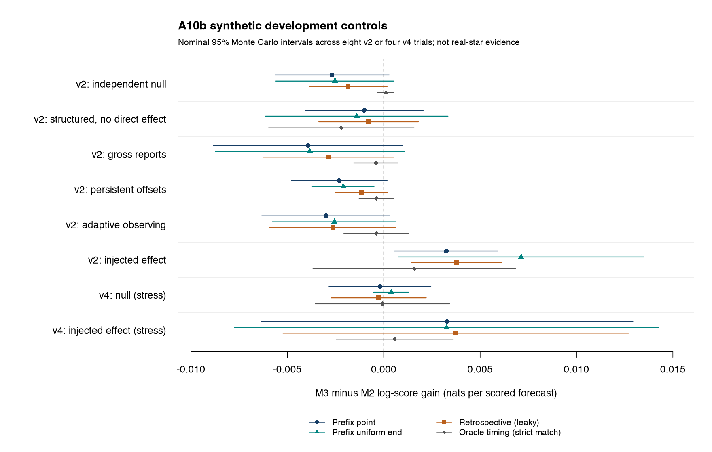

# A10b: causal forecast ledger and full-chain synthetic model controls

Codex, 8 November 2026. Review base `5476d00`; first implementation freeze
`bd8fa238e0811699cf22311596b9bcd606570638`; repaired freeze
`4fc8d2eafa803b4890b90346d906a7ac13878d39`. This is a model-development
pilot, not the A10 real-evaluation freeze or a result from SS Cyg forecasts.

All 56 trials and 105,509 variant scores are reconciled. The injected-effect
prefix forecast gain averages 0.00324 nats; single-history diagnostic intervals
remain wide. Forecast gain stays confirmatory under Barry's D018 decision.

## Decisions and review findings

Barry explicitly retained **held-out forecast gain as confirmatory** (D018).
The duration coefficient remains secondary. The A10a Gaussian calculation
checks numerically: at r=0.12 and 390 forecasts, the approximate powers are
0.326 for score gain and 0.769 for a coefficient fitted on evaluation outcomes.
They concern different claims. The 5,000-replicate precision file extends the
existing Claude program and random namespace; it is not an independently
authored full-chain power calculation. A wide interval must not be read as
absence of predictive information.

The claim that prefix causality makes waveform errors capable only of diluting
skill does not hold. With constant true duration, an end error changes measured
duration and measured landmark age in opposite directions. A duration mark can
therefore improve remaining-time forecasts by correcting age, with no physical
duration–gap relation. An independent exact six-state example gives 0.087208
nats of improvement. This is a counterexample, not an estimate of SS Cyg bias.
It distinguishes measured-baseline forecast information from physical memory.
The complete-gap covariance approximation is not a bound on forecast gain.

The real prefix versus retrospective duration difference of about 0.05 d in
A10a measures the cost of restricting information availability. Neither
estimate is known truth, so their difference is not a measure of endpoint
accuracy or a bound on total measurement error.

## Ledger and model implementation

`a10-prefix-v2` corrects four consequential behaviors found in code review:

- A two-day delay cannot replace an onset already before issue with a later
  event. The issuance is retained and flagged as overtaken.
- A monitoring hole crossing issue retains its full length; issue does not
  restart the coverage clock.
- Block membership uses issue time, with the preceding repeat-alert context
  preserved. Negative previous gaps are unavailable rather than covered.
- Training outcomes are freshly extracted after restricting observations to
  the fit cutoff. Filtering final retrospective outcomes by issue time would
  leak later evidence. Unresolved outcomes remain censored at the cutoff.

Onset brackets straddling issue do not establish survival and are commonly
excluded with a recorded reason. Zero-exposure censors stay in the ledger
with zero log probability for every model. Every issued forecast remains in
the trace, including repeats, false alerts, unknown landmarks and common
exclusions. Evidence has conservative `computed_as_of = evidence_available_at`
certificates. This implements frozen fitting, not online availability or an
operational archive replay.

The new `ledger_forecast.py` implements statistical lognormal clocks:

| Model | Predictors beyond the clock |
|---|---|
| M0 | none |
| M1 | previous outburst log duration |
| M2 | covered previous log quiet gap |
| M3 | same M2 timing architecture plus log duration |

All clocks condition on survival to issue. Interval observations contribute
log interval probability minus log survival to landmark age; right-censored
observations contribute a survival ratio. Missing duration routes M1 to M0
and M3 to M2; missing covered previous gap uses the corresponding simpler
model. An unknown end makes **all four** use the common issue-anchored R0
remaining-wait model. Training centers and scales are frozen. M2 is an AR-gap
benchmark, not an identified latent activity model or the final strong
timing-only comparator. The structured control uses a serial Gaussian copula
with latent-rank gap persistence 0.382 and duration persistence −0.4, rather
than a separate unobserved activity-state process. It cannot qualify M2
against every form of changing activity.

The shared-end sensitivity uses five uniform end nodes, changing duration,
age and outcome offsets jointly. It takes a ratio of numerator/survival
mixtures, rather than averaging conditional ratios. Onset and previous gap
remain fixed. This is partial measurement sensitivity, not a calibrated joint
endpoint posterior. Type plus within-type duration (12 d split) and two-day
issuance delay are diagnostics in the predeclared subset. The two-day
variant does not shift the availability of training records; it is not a
globally lagged reporting or operational replay.

Stable normal log-CDF/survival differences avoid probability floors. Fits use
two fixed bounded L-BFGS-B starts with explicit convergence/boundary records;
an optimizer's success on a constant penalty plateau is rejected. A separate
scalar calculation checks the vectorized likelihood, including mixed one- and
five-node rows. Relevant numerical contracts are in the official
[SciPy log-CDF](https://docs.scipy.org/doc/scipy/reference/generated/scipy.special.log_ndtr.html)
and [optimizer documentation](https://docs.scipy.org/doc/scipy/reference/optimize.minimize-lbfgsb.html).

## Preserved implementation failure and repair

The first controls run stopped after 17 returned trials: eight successful,
nine duration-domain exceptions and 39 unfinished tasks. All 12,408 emitted
score rows and the full returned records remain outside Git; a compact public
aborted-run record preserves their hashes and statuses. Its successful subset
is not a completed pilot and is not combined with the repaired run.

An independent exact null/0 replay found two valid positive point durations
whose marginal end intervals extend 0.363 and 0.060 d before the fixed point
onset. The shared-end sensitivity attempted to evaluate their logarithms
before fitting. This is incoherent derived-mark support, not evidence of a
negative physical duration or a failed point episode.

The explicit repair makes duration unavailable for the whole mixture if any
node is nonpositive. M0/M2 keep every end node and their timing information;
M1/M3 use their declared missing-mark fallback. No node is clipped, truncated
or deleted, and no issuance is dropped. Domain diagnostics retain affected
indices, minimum margins, point-invalid geometry and interval-only overlaps
separately, for all and score-eligible training/evaluation rows.

The repaired source was frozen before repeating concordance and the entire
56-trial grid. Control seeds are pinned to the original `bd8fa23` namespace,
independently of the new source hash. This prevents a favorable random reroll;
it does not create a new independent test sample.

## Experiment and independent checks

The independent ledger author received the contract and frozen X4/visit
primitives, without candidate ledger source or tests. At each freeze, exactly
100 three-year histories were compared at both zero- and two-day latency;
all feature/evidence fields and canonical hashes matched (200 comparisons per
freeze). These are short implementation checks, not 100 real-sized model
qualification records.

Each control trial generates about 50 development years followed by 58
evaluation years on an artificial timeline, using only retained pre-1960
source-pattern strata. Integer translations preserve night bins; empty 30 d
seams force coverage censoring between independent blocks. No actual
1960–2017 cadence, outcome or coverage count was used.

The fixed grid has eight v2 trials each for independent null, structured
zero-direct-duration effect, gross errors, persistent observer offsets,
adaptive observing effort and injected effect; four v4 trials each for null
and injected effect. V4 and the causal adaptive policy are unqualified stress
conditions. Gross/offset/adaptive trials share null random streams for paired
comparisons, while replicate IDs are independent.

Prefix point, prefix uniform-end, retrospective-current-boundary and oracle
timing views use the same issuance/evidence population. Retrospective timing
is knowingly leaky. Oracle timing is supplied only for a unique true episode
completed by issue; unmatched/premature/false issuances stay with common R0
fallback. No truth eligibility filter is applied to the primary ledger.

## Completed pilot results

All **56/56** trials completed without exception: **105,509 scored
variant-issuances**, **272 variant populations** and **1,360 fitted models**.
Repeated representations of the same issuance are not independent forecasts.
The run took 2,659 s with four local workers. Both starts converged for every
fit; no selected parameter was on a bound. The largest start-objective spread
was 1.67×10⁻⁶. These are numerical diagnostics, not model validation.

The primary prefix-point M3−M2 estimates are nats per scored issuance. Each
row averages the trial means equally; the interval is a nominal Student-t
Monte Carlo interval across eight or four simulated histories.

| Family / case | Trials | Mean scored issuances | Mean M3−M2 | Trial SD | Nominal MC95 |
|---|---:|---:|---:|---:|---:|
| v2-phase / independent null | 8 | 388.50 | -0.00268 | 0.00355 | [-0.00565, 0.00028] |
| v2-phase / serial, zero direct mark | 8 | 386.75 | -0.00101 | 0.00365 | [-0.00406, 0.00204] |
| v2-phase / gross reports | 8 | 394.38 | -0.00393 | 0.00586 | [-0.00883, 0.00097] |
| v2-phase / persistent offsets | 8 | 390.00 | -0.00230 | 0.00296 | [-0.00478, 0.00017] |
| v2-phase / adaptive observing | 8 | 368.62 | -0.00300 | 0.00398 | [-0.00633, 0.00032] |
| v2-phase / injected effect | 8 | 396.25 | 0.00324 | 0.00321 | [0.00056, 0.00592] |
| v4-phase / independent null | 4 | 388.75 | -0.00020 | 0.00166 | [-0.00284, 0.00244] |
| v4-phase / injected effect | 4 | 388.50 | 0.00329 | 0.00606 | [-0.00635, 0.01292] |

Under the v2 injected effect, seven of eight block gains are positive, with
mean **0.0032424** and trial SD **0.0032063**. All eight individual three-year
cluster intervals include zero. This is positive average recovery in the
conditional benchmark, alongside limited precision at a single-history scale;
it is not an eight-trial power estimate or a result about real SS Cyg.

The serial control demonstrates that the timing comparator learns structure:
M2−M0 is **0.03793** [0.02579, 0.05006], while M3−M2 is **−0.00101**
[−0.00406, 0.00204]. This control has no separate hidden activity-state process.
All 36 paired gross/offset/adaptive-minus-null intervals include zero. That
is not evidence that small observation-process effects are absent.

Uniform-end injected-effect gain is 0.00713 [0.00075, 0.01351], with trial SD
0.00763; the type/within-type diagnostic is 0.00029 [−0.00598, 0.00655] in four
trials. These noisy estimates do not select a representation. All 132 raw gain
groups, including both delays and all three comparisons, and all 36 paired
stress contrasts remain in the public tables.



**Domain and oracle qualifications.** Across the 56 base prefix populations,
nonpositive point durations occur in 1/18,725 known training landmarks and
3/21,647 known evaluation landmarks. Uniform-end support is nonpositive in
28 and 29 respectively. These observations retain timing and use the stated
mark fallback. One additional evaluation point-order failure appears only in
the retrospective view. Across diagnostic variants these are seven repeated
point-invalid entries, not seven unique physical episodes. This rare geometry
still needs an explicit ordering policy before a real-evaluation freeze; the
pilot does not certify physically ordered endpoints.

The strict oracle matcher requires the first bright report to fall within a
unique true event that has ended by issue. It supplies oracle timing for
16,076/21,705 scored base-view issuances; the other **5,629 (25.9%)** use R0.
Those counts mix failed matching and premature/false signals and cannot be
read as false-alert rates. The oracle is a partial diagnostic, not an
upper bound, and its gain cannot measure a percentage of skill retained by
extraction. Matching should be reviewed before making that comparison.

**Independent numerical reconciliation.** A separate author reconstructed
conditional lognormal probabilities, routes, mark transformations, end mixtures
and cluster intervals without reading candidate model source/tests. On final
v2 null/alternative and v4 alternative replicate 0, all **8,165** score rows
match within 5.7×10⁻¹⁴ nats, with no route, interval or domain discrepancies.
A positive-tail cancellation defect in the checker initially caused ten v4
discrepancies up to 2.16×10⁻⁸; it was corrected against standard normal-CDF
fixtures without changing candidate models or relaxing the 10⁻⁹ criterion.

A second independent program reconstructed all **132 aggregate groups and
36 paired contrasts** directly from score rows: all sets/counts and audited
summary fields match, maximum numerical difference **0**. The root
reconciliation verifies every fitted training population and route count,
conservative evidence cutoffs, and exact reproduction of all eight successful
pre-repair trial results on their original fields. Failed initial trials were
not salvaged into this full replay.


## Limits and next work

Eight/four trials estimate pilot behavior with large Monte Carlo uncertainty;
they cannot calibrate final power, type-I error or the absence of small
measurement artefacts. Three-year cluster intervals inside each trial are
diagnostic, not the frozen confirmatory test. Across-trial intervals summarize
random simulation variation, not uncertainty about benchmark realism.

A structured zero-direct-effect process may yield real incremental information
from duration as an activity proxy beyond a noisy AR-gap baseline. Conversely,
uniform end propagation does not guarantee removal of the age-error route.
Informative observation, missed episodes, stronger timing architectures,
parameter uncertainty and complete endpoint propagation remain open.
The oracle timing view also changes the timing baseline and finite-sample
fits; its incremental gain is not an information upper bound or a denominator
for a forecast-skill retention percentage. The pilot does not select among
point, uniform-end and type/within-type representations.

No raw archive download, native photometry access, real duration–following-gap
fit or protected observation access occurred in this tranche. The retained
benchmark cache is derived only from the open era. A10 remains unfrozen.

## Reproduction and retained evidence

- [Frozen specification](../protocols/a10b-model-controls-v1.md), D018/D019;
  [completed receipt](../../data/simulations/a10b_controls_20261108/receipt.json),
  [all gain rows](../../data/simulations/a10b_controls_20261108/forecast_gains.csv),
  [fit diagnostics](../../data/simulations/a10b_controls_20261108/model_diagnostics.csv),
  [domain counts/IDs](../../data/simulations/a10b_controls_20261108/duration_domain_diagnostics.csv).
- [Independent aggregation audit](../../data/simulations/a10b_controls_20261108/aggregation_audit.json),
  [fit/route replay reconciliation](../../data/simulations/a10b_controls_20261108/reconciliation.json),
  and three `score_audit_*.json` files in that directory.
- [Aborted first run](../../data/simulations/a10b_aborted_controls_20261108.json);
  [logical age-error counterexample](../../data/provenance/a10b_landmark_counterexample.json).
- [Shared payload manifest](../../data/simulations/a10b_controls_20261108/shared_payload_manifest.json):
  85 files, 562,464,357 bytes, mirrored in the shared project directory
  `a10b-20261108-4fc8d2e` and verified individually by SHA-256. Full generated
  tables and the frozen benchmark cache remain outside Git. The shared area
  is working storage, not an independent backup or a public data release.
  Exact replay requires that cache; the public hash alone is not the input.

To regenerate the experiment, use a clean worktree at the source freeze and
restore `outputs/a04i_inputs_frozen_20261108/inputs.json` from that manifest:

```bash
git worktree add /tmp/dnmem-a10b-replay 4fc8d2eafa803b4890b90346d906a7ac13878d39
cd /tmp/dnmem-a10b-replay
uv sync --frozen --extra analysis --python 3.14.4
uv run --frozen --extra analysis python scripts/a10b_pipeline.py concordance \
  --freeze-commit 4fc8d2eafa803b4890b90346d906a7ac13878d39 \
  --output outputs/concordance_replay --workers 4
uv run --frozen --extra analysis python scripts/a10b_pipeline.py controls \
  --freeze-commit 4fc8d2eafa803b4890b90346d906a7ac13878d39 \
  --concordance outputs/concordance_replay/receipt.json \
  --output outputs/controls_replay --workers 4
```

The receipt records Python 3.14.4, NumPy 2.5.4 and SciPy 1.18.1. Source,
inputs, seeds and environment are explicit; solver digits may vary across
platforms. The checked same-environment original-stream replay is exact.
The source freeze intentionally refuses a dirty or different HEAD.

From the results checkout, with retained outputs available, the independent
and compact-export tools are:

```bash
python scripts/a10b_reconcile.py outputs/a10b_controls_repaired_20261108 \
  outputs/a10b_controls_20261108 outputs/reconciliation.json
python scripts/check_a10b_aggregation.py \
  --input-dir outputs/a10b_controls_repaired_20261108
python scripts/check_a10b_scores.py \
  --trial outputs/a10b_controls_repaired_20261108/v4-phase-alternative-000.json \
  --scores outputs/a10b_controls_repaired_20261108/scores.jsonl \
  --output outputs/v4_score_check.json
python scripts/a10b_publish_summary.py outputs/a10b_controls_repaired_20261108 \
  outputs/compact_replay
Rscript scripts/plot_a10b_controls.R outputs/compact_replay/forecast_gains.csv \
  outputs/compact_replay/gains.png
```

Use the locked analysis environment for these Python commands. The figure
uses base R with Cairo; PNG layout was visually checked. Final local checks:
257 tests, the structural seed validator and all sixteen numerically reproduced
seed tables pass. CI and the staged scan are recorded with the closing commit.

Next: Claude — review the controls, oracle matching and point-order policy;
settle the stronger timing-only comparator and the next development-fit tranche
before the A10 evaluation freeze.
