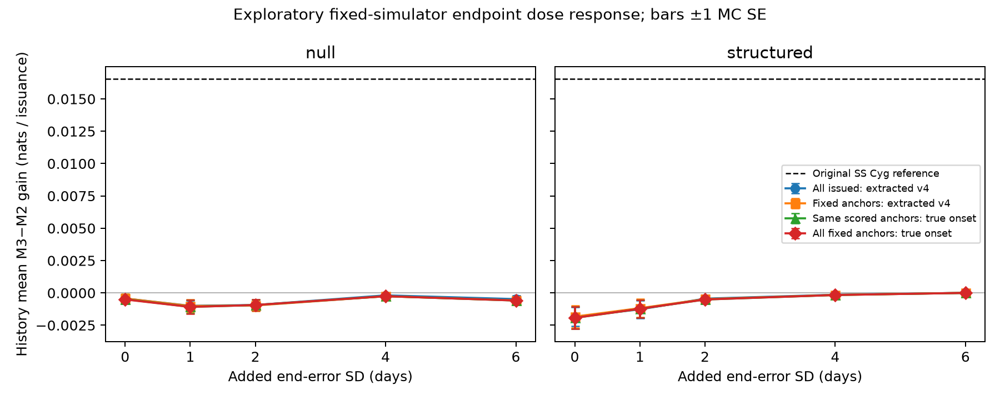

# R1: observation scores, censoring and endpoint information

Codex, 9 November 2026. Research resumed after the GPT-6 Pro review and Claude's
A10n triage. D033 amends that triage. The [protocol](../protocols/r1-observation-endpoint-diagnostics-v1.md)
and complete new implementation/tests were committed at `0594146` before new
real-data sensitivity scores or synthetic dose scores were inspected. These
are post-result diagnostics, not another confirmation. No manuscript product
was rewritten; no archive request, new-star record or SS Cyg 2018+ observation,
count or coverage summary was accessed.

## What the original statistic establishes

The original +0.0165335 nats per issuance is reproduced as a difference of
specified **working interval log scores** for archive/extractor-defined outcomes.
Its reported CR1 interval remains [0.0049477, 0.0281193]. The finding has not
established a proper observation likelihood for latent visual onset. Visual
magnitude-ten crossing is itself distinct from physical disc-instability onset.

The [independent contract audit](2026-11-09-r1-observation-contract.md) derived
three amendments before sensitivity scoring:

- Decisive noisy visual estimates do not establish error-free bright/faint
  states, complete detection of the first crossing or an ignorable reporting
  mechanism. Visit timing alone does not prove coarsening at random for the
  selected report, episode and risk set.
- X4's `_clip` returns an envelope when fitted and report intervals conflict or
  touch. It does not invariably nest a posterior interval inside report bounds.
- The normalized X4 crossing kernel has an absolute-slope Jacobian tilt; point
  selection, plug-in variance and clipping are not a proved generative likelihood.

Agreement between different working scores would be stability evidence. It
would not close these observation-model issues.

## R1a: actual censoring candidates and prospective repair

The audit reconstructs the **builder's actual first eligible confirmed episode**,
including episodes that never emitted a forecast. Both frozen evidence builders
reproduce all primary evidence records. Among the six original censors, four
coverage candidates and one supersession candidate start beyond their stopping
cutoffs; the record-end case has no candidate. No fitted onset set straddles a
cutoff. The separately versioned v4 correction changes **0 of 441** outcomes.

The six contributions total −0.0067990 nats. Deleting all six gives +0.0167772
per remaining forecast. This deletion is a descriptive sensitivity, not a bound
on every possible observation-model correction.

`outcome_evidence_v4.py` implements future working-set backoff to L when
issue < L < C < U, retaining the administrative cutoff and reason. The frozen
production/reference v3 sources remain unchanged. An independently derived v4
reference agrees on the real ledger and 18 synthetic boundary cases. This fixes
the internal interval-containment rule; it does not turn uncertain X4 bounds
into known physical survival bounds.

## R1b: sensitivity scores and their availability

Frozen parameters, issuance times, features and candidate associations are kept.
Every original X4 onset interval and point estimate is exactly reconstructed
across all 860 retained episodes, including unconfirmed neighbouring episodes.

**The proposed two-sided report-interval comparison is largely unavailable.**
Among 440 associated candidates, 434 lack a finite lower report clip; one of
those also lacks the upper clip. One forecast has no candidate. X4's frozen
construction looks for the first far-bright report after the previous peak,
which can still belong to that previous outburst's fading tail. Independent
delegate and parent checks find that **all 434** missing cases contain decisive
faint reports, but their first far-bright report precedes their last far-faint
report and there is none between the previous peak and that first bright report.
This ordering is consistent with the tail explanation, without independently
assigning physical episode membership. See `clip-diagnostic.json` for aggregate
counts and an invented numerical example. No revised clip was invented after
seeing these results.

| Working outcome summary | Contrasts | Mean gain | 90% six-year CR1 interval | Original score on same subset |
|---|---:|---:|---|---:|
| Decisive-report interval | 11 | −0.018101 | [−0.045489, 0.009287] | −0.013479 |
| X4-kernel compatibility | 11 | −0.014341 | [−0.035497, 0.006816] | −0.013479 |
| Saved-point density | 441 | +0.015404 | [0.003443, 0.027365] | +0.016534 |

The 11 contrasts comprise six computed contrasts and five exact identical-model
fallback zeros; four of those zeros themselves lack clips. Only three calendar
blocks contribute. On this same subset the original score's interval is
[−0.033208, 0.006250], and saved-point gain is −0.014505 [−0.035934, 0.006924].
These small selected-subset comparisons neither reproduce nor overturn the
441-forecast result. In particular, they cannot establish the predicted full-
population agreement within ten percent.

Saved-point density is available for all 441. Its gain is 6.83% below the
original working score, with paired change −0.001130 [−0.001746, −0.000513]
and rank correlation 0.993763. It retains the six original censors and scores
435 point extractions. No cutoff straddle or censor-to-event promotion occurs.
The point estimates remain uncertain extractions, not known latent onsets.

The independent scalar route agrees on 882 original terms to 1.40e−13, 28
alternative interval/survival terms to 4.45e−16, and 860 point-density terms to
1.78e−15. Adaptive integration and 128-node composite Gauss–Legendre quadrature
agree on all eight nontrivial kernel terms within 1.31e−12 log units. No
Gaussian tail inside the finite clips was discarded and no epsilon repair was
used. The parent separately recomputed the full point-score mean and CR1
interval from retained paired gains.

## R1c: endpoint dose experiment

All 80 original histories are present exactly once: forty null and forty
structured (gap-dependent) histories, each at five added-error doses. All ten
all-issued scenario/dose mean gains are zero or negative. Neither extracted
outcomes nor matched true-onset scoring approaches the real +0.01653 reference.

| Setting | Added SD (days) | All-issued extracted | Matched-anchor extracted | Same-anchor true onset |
|---|---:|---:|---:|---:|
| null | 0 | -0.000435 (0.000314) | -0.000433 (0.000342) | -0.000485 (0.000354) |
| null | 1 | -0.000997 (0.000425) | -0.001013 (0.000485) | -0.001079 (0.000514) |
| null | 2 | -0.000940 (0.000403) | -0.000971 (0.000427) | -0.000940 (0.000423) |
| null | 4 | -0.000190 (0.000097) | -0.000256 (0.000147) | -0.000256 (0.000148) |
| null | 6 | -0.000480 (0.000274) | -0.000581 (0.000319) | -0.000590 (0.000327) |
| structured | 0 | -0.001843 (0.000746) | -0.001834 (0.000871) | -0.001932 (0.000860) |
| structured | 1 | -0.001274 (0.000680) | -0.001180 (0.000711) | -0.001232 (0.000702) |
| structured | 2 | -0.000444 (0.000280) | -0.000484 (0.000329) | -0.000512 (0.000348) |
| structured | 4 | -0.000144 (0.000111) | -0.000160 (0.000128) | -0.000162 (0.000130) |
| structured | 6 | +0.000000 (0.000000) | +0.000000 (0.000000) | +0.000000 (0.000000) |

Values are equally weighted **history means** in nats per issuance, with MC SE
in parentheses, from forty independent histories per setting. These MC SEs
describe the simulation average, not an interval for the real result. The
all-fixed-anchor true-onset route is also retained in the aggregate evidence;
it includes the ten anchors excluded from extracted scoring across both cases.

The separately fitted sigma-zero composite-oracle truth gains are −0.000510
(MC SE 0.000544) for null and −0.002091 (0.000737) for structured. The oracle
changes true ends, durations and gap history together, so the comparison cannot
attribute everything specifically to the current end. The v4-minus-v3 sigma-zero
all-issued changes average +0.0000025 (0.0000030) and +0.0000029 (0.0000045),
respectively. They are kept separate from dose effects.

**Limits matter here.** This adds iid errors to estimated ends after extraction
while holding issuance and onset estimates fixed. It does not regenerate
photometry or alert timing, and it does not test systematic/state-dependent
errors or unseen light curves. The truth-anchor check deliberately selects
genuinely completed, still-quiescent truth-matched first emissions. Across the
whole histories, about 26% of emissions are unmatched/false under that strict
matching rule. That category can include a noisy first bright report just
before a real rising crossing. The anchor target is not the entire 441-forecast real estimand.

Large doses also disable landmarks and route forecasts to common R0. At six
days, about 35% of scored all-issued forecasts in both families use R0; all
forty structured duration fits are at zero. The zero gain is therefore not a
certification of calibrated physical onset forecasts. Small/nonpositive gain
only limits this added iid mechanism under the fixed simulator. Neither the
A10n 0.004 threshold nor the six-day counterexample supplies a general bound
on real artefact.



Bars show ±1 MC SE; the dashed line is the original real working-score reference.

Execution is fully disclosed. Freeze `0594146` produced 79 successful histories
and one pre-scoring retained-ledger equality failure. Eight entries involving
two `math.log` values differed by one floating step (4.44e−16); event times,
marks, coverage and eligibility matched exactly. A [gain-free diagnosis and
comparison-only recovery protocol](../protocols/r1-numerical-audit-recovery-v1.md)
preceded repair freeze `93e52e6` and same-seed recovery. Every other runner
function and all fifteen scientific dependencies remain unchanged. Original
and recovery receipts are retained, including the failure. No predictor was
rounded or replaced.

A post-freeze outside-grid scored smoke was also an additional development run
beyond the written preparation-only smoke. Its receipt and [execution note](../protocols/r1-execution-addendum-v1.md)
are preserved; no gain was inspected or source tuned from it.

Independent scalar checks of two initial histories plus the recovered history
cover **10,392 M2/M3 truth scores** across all doses/oracles, agreeing within
3.56e−15, and **4,696 retained-parameter legacy scores**, within 5.69e−14.
The positive-offset arithmetic is exercised by null001, selected for that
parameter branch rather than its scientific result. All audited anchor sets,
routes and common subsets agree. Coverage cutoffs use separately retained
administrative metadata rather than an independent raw-visit reconstruction.

Across all eighty histories, frozen-parameter replay means agree within
3.3e−16; newly optimized legacy-refit means can differ by 5.3e−9. Individual
absolute refit scores differ by up to 8.42e−7 in the audited cases. Refit and
retained-parameter replay are different calculations: the first-pass mistaken
equality comparison is preserved, and the 1e−9 replay tolerance was not changed.

## R1d/e: example and finite simulation evidence

Independent scalar erfc/inverse-normal calculations reproduce Figure 1's
date-selected point-end example:

| Quantity | M2 timing baseline | M3 with duration |
|---|---:|---:|
| Median remaining wait | 27.5749 days | 26.7726 days |
| Probability within 30 days | 57.6727% | 60.2765% |

The selected feature/outcome hashes match the frozen figure aggregate. The
entire saved CDF grid agrees within 1.95e−16; interpolating its medians differs
from the analytic calculation by less than 0.00019 day. These are one selected
forecast, not average accuracy or observing utility. C42 records the example.

All 480 A10d comparison rows and A10n numerical aggregates reproduce. The
[per-setting table](../../data/provenance/r1_20261109/simulation-table.md)
adds exact binomial intervals, MC SEs and maxima. The real mean exceeds every
scenario **mean**, but eight of the 360 individual-history means reach or exceed
it. The maximum is 0.039568 in the slow-state φ=0.98 setting; the injected-effect
setting's maximum is 0.027688. Small scenario averages do not exclude all
observation mechanisms in the real record.

For six-year joint-MC reference containment, null overall is 37/40 versus
24/27 among interior fits; injected-effect overall is 34/40 versus 31/37
interior. Exact-zero identity fits inflate the overall containment count.
Six finite matched references do not supply a known exact expected gain.
The finite screen does not certify a population five-percent error rate or
coverage guarantee. Correcting A10n's half-day block-origin typo changes zero
of the 441 actual assignments.

## Evidence and reproduction

Public aggregate evidence is in `data/provenance/r1_20261109/`; full native
observations, episode catalogues and per-issuance scores remain ignored and
unreleased. Commands require the retained local inputs; they make no archive
requests and refuse occupied output directories.

```sh
.venv/bin/python scripts/r1_censor_audit.py --help
.venv/bin/python scripts/r1_observation_scores.py --freeze-commit 0594146 --output outputs/r1b_reproduction
.venv/bin/python scripts/r1_endpoint_dose.py --freeze-commit 93e52e6 --workers 4 --output outputs/r1c_reproduction
.venv/bin/python scripts/r1_example_simulation_table.py --help
```

The actual-candidate audit verifies the original 120 execution source blobs at
the repair commit, 26 currently unchanged forecasting sources, 15 retained run
outputs, all 63 evaluation and 12 development native input leaves and the frozen
parameter hash. The one intentional current execution-file difference is the
later structural validator, already documented in A10k. Native provenance,
original run and parameter bytes are preserved.

## Handoff to R2

I agree with one integrated expanded study and the M2 / evolving-level /
filtered-state timing ladder, each with a matched duration term. The current
R1 findings make **the observation target and measurement model the first design
task**, alongside the stronger baseline. A corrected finite clip algorithm
alone will not establish the missing CAR or reporting model. Choose explicitly
between forecasting an observable extraction/report target and modelling latent
threshold onset; the latter needs a defensible observation/selection likelihood.

Before new access, the R2 design should fix the cohort and development/test
splits, classification/exposure ledger, development-only qualification and
dropout rules, one aggregate primary comparison, weights and dependence model,
multiplicity, and achievable precision. Duration/type models must nest the same
baseline exactly, including recentering and missing-data routing. Online state
updates use only outcomes available by issue and propagate state uncertainty.
Check the suggested candidates' classifications rather than treating the sketch
as an eligible cohort. Retain excluded stars in the screening record.

Other-star archive opening still requires Barry's decision on the concrete
design. No invitation is sent to a specialist without his authorization.
SS Cyg 2018+ remains closed. The present through-2017 work is exploratory and
cannot become a second confirmation. Manuscript products remain paused until
the research and these interpretations are reviewed.
