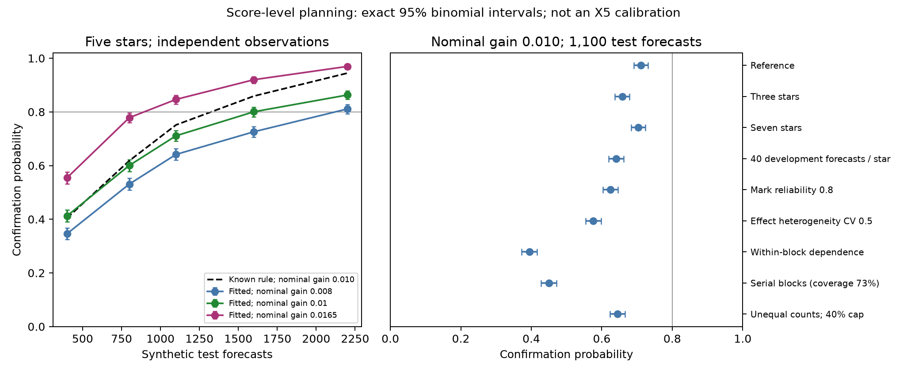

# R2c: catalogue cohort and synthetic precision planning

Codex delegate, 9 November 2026. Scope: catalogue/literature screening and a
score-level power study. No AAVSO observations, observation counts, coverage
queries or light curves were requested. No SS Cyg 2018-onward information was
read. The catalogue versions used here predate 2018. Raw catalogue responses
and papers remain in ignored `outputs/r2c_sources/`; extracted metadata and
source hashes are in `data/provenance/r2c_catalogue_power/`.

## Cohort recommendation

Nominate **SS Aur, RU Peg, AR And, X Leo, TW Vir, UU Aql, CH UMa and DX And**
for a development-data feasibility screen. This is a queue of candidates, not
an eligible or adequately powered sample. Hold **U Gem and IP Peg** out of an
initial primary cohort pending explicit treatment of eclipses; U Gem also has
a catalogue subtype ambiguity. Preserve all nominated and excluded objects in
the screening ledger. BV Cen fails the proposed northern/equatorial geography;
Z Cam, RX And, SU UMa and WZ Sge are outside the ordinary first-cohort classes.

The primary catalogue is [Ritter–Kolb 7.24](https://wwwmpa.mpa-garching.mpg.de/RKcat/),
the final edition dated 31 December 2015. Its `DN/UG` code denotes ordinary
U Gem/SS Cyg systems. Its table gives the first eight nominees that designation;
U Gem additionally has `SU?`. This is source-verified historical classification,
not a guarantee against later reclassification. [Catalogue fields](https://wwwmpa.mpa-garching.mpg.de/RKcat/descr.online)
and [original catalogue paper](https://arxiv.org/abs/astro-ph/0301444).

The independently archived [Downes catalogue](https://archive.stsci.edu/prepds/cvcat/)
was frozen in February 2006. It calls U Gem/RU Peg `UGSS`, SS Cyg `UGSS`, and
the other ordinary nominees `UG`. The two catalogues are not wholly independent:
Downes uses Ritter–Kolb as a main magnitude source. They support nomination,
not proof of uniform outburst physics. [Field definitions](https://archive.stsci.edu/prepds/cvcat/description.html).

## Constants must name their source and passband

The v0 statement that a range-midpoint rule gives SS Cyg 10.0 can be correct.
Downes gives 8.2v–12.1v; its midpoint is 10.15, which rounds to 10.0 at 0.5-mag
resolution. RK gives the same full range. In RK, **mag1 is bright quiescence,
mag2 is faint quiescence or mideclipse, and mag3 is maximum outburst light**.
Taking mag1 and mag2 as the outburst range would be a different operation.

The CSV supplies provisional constants from RK mag3/mag2, with explicit
half-step ties rounded towards the fainter numeric magnitude. RK's unqualified
magnitudes are V; these are catalogue-V anchors, not a calibrated conversion
to visual estimates. Downes distinguishes visual `v`, Johnson `V` and
photographic `p`. In particular DX And's Downes range is photographic: it
cannot silently be treated as a visual range.

| Star | RK outburst maximum / faint value | Proposed midpoint | Proposed margin B | Caveat |
|---|---|---:|---:|---|
| SS Aur | 10.5 / 16.0 | 13.5 | 1.0 | Downes instead lists 10.5v–14.5v |
| RU Peg | 9.5 / 13.1 | 11.5 | 0.9 | Source choice changes both constants |
| AR And | 11.0 / 17.6 | 14.5 | 1.0 | Historical subtype debate |
| X Leo | 11.5 / 16.7 | 14.0 | 1.0 | Broad published recurrence range |
| TW Vir | 12.0 / 17.2 | 14.5 | 1.0 | Development depth unmeasured |
| UU Aql | 11.0 / 17.0 | 14.0 | 1.0 | Equatorial/southern edge |
| CH UMa | 10.5 / 16.0 | 13.5 | 1.0 | Long nominal recurrence |
| DX And | 11.5 / 15.5 | 13.5 | 1.0 | Photographic alternative range |

These are proposals for review, **not frozen extraction thresholds**. Catalogue
extrema can mix rare events, quiescent variation and eclipse minima. For IP Peg,
RK has bright quiescence 14.0 but faint/mideclipse 17.8, illustrating why a
range midpoint may be inappropriate. RK's eclipse flag counts eclipses per
orbit; its value two does not mean eclipse depth. No observing density or
threshold-crossing quality has been measured here.

## Literature exposure

The machine-readable `literature-exposure.csv` records source, exact inspected
section and unresolved access limits. Published earlier analyses overlap parts
of the proposed test years, even though this project has not opened the new
archives. A future freeze must describe a held-out fitting comparison, without
claiming that every scientific outcome in those years was previously unknown.

[Szkody & Mattei (1984)](https://adsabs.harvard.edu/pdf/1984PASP...96..988S)
analysed 9 September 1974–5 June 1977, explicitly JD 2442300–2443300. Their
ordinary-system table includes AR And, SS Aur, U Gem, X Leo and TW Vir. X Leo
also appears in their individual-correlation table. They list historical
SU-candidate suspicions for X Leo, AR And and CH UMa, while their period
argument says AR And/X Leo probably are not SU systems. Those historical
suggestions do not override RK's later ordinary classifications.

[Ak et al. (2002)](https://nek.istanbul.edu.tr/ekos/MAKALE/M7229.pdf), Table 1,
reports RU Peg and SS Aur 1961–1997, TW Vir 1955–1997, U Gem 1963–1995,
UU Aql 1984–1997, and BV Cen 1954–1997. Thus some proposed 1990–2025 years
already contribute to descriptive results. The original PDF's parsed text was
read; its raw download timed out and page rendering was unavailable this turn.
That acquisition limitation is retained rather than inventing a checksum.

[Šimon (2022)](https://arxiv.org/html/2112.03620v1) supplies a RU Peg morphology
and recurrence precedent, with a typical cycle near 90 days. Its exact time
span was not recoverable from the inspected narrative without consulting the
light-curve figure, which was deliberately not inspected here. RK's nominal
76-day recurrence is therefore not a fixed physical constant. For IP Peg, CH UMa
and DX And the bounded search has not established a complete recurrence-study
exposure history; an empty entry is not a novelty claim. Classification searches
also exposed published IP Peg eclipse-campaign years and a search snippet of
1999 outburst context. Those incidental exposures are logged; no light curve
was opened and they do not determine constants, counts or power. The original
Smak–Waagen abstract supplies the U Gem 1985 subtype warning.

## Calendar and count planning

The proposed split JDs are correct: 1990-01-01 is 2447892.5 and 2026-01-01
is 2461041.5. The test spans **36 calendar years / 13,149 days**, giving six
six-year blocks per star. A 2018–2025 reserve would remove eight years, 22.2%
of that calendar span; no later observations were read to compute this.

RK's T1 is the typical outburst-to-outburst interval, not the quiet gap. It
can inform hypothetical available cycles, but neither catalogue establishes
the number of scoreable forecasts. Unknown monitoring, missing events,
eclipses, faint peaks and development qualification can all reduce that count.
No retained-forecast count or G2 pass is inferred from these catalogues.

## Power study specification

The proposed 35-case design is in `power-design.json`. It uses paired Gaussian
log-score differences, a positive pooled coefficient fitted on synthetic
development only, and the same test draws for known/fitted rules. The primary
weighted statistic iteratively caps any star at 40%, which requires at least
three qualified stars; uncertainty uses the
proposed star-by-six-year CR1/t rule. Exact binomial intervals accompany rates.
Overall and positive-coefficient coverage are separate, because a zero rule
has exactly 100% interval coverage by identity.

For a standardized error-free mark x and unit residual variance, an optimal
coefficient a gives score gain g = a*x*y − a²*x²/2. Its mean is μ=a²/2 and
variance is **2μ + 2μ²**. Holding a score SD of 0.133 fixed across effect
sizes is a separate planning assumption. The quantity 0.0063203*sqrt(441)
is an effective scale from one clustered real result; it is not an estimated
iid forecast SD or a universal variance law.

The dependence cases explicitly correlate both marks and residuals within
blocks. Correlating residuals alone while independent mean-zero marks multiply
them would not create corresponding score correlation. A serial-block case
intentionally challenges independence across the declared CR1 clusters.
Population standardization and predictive variance are known in this toy;
state-filter learning, photometry, extraction, censoring and qualification are
not simulated. This is **score-level precision planning**, not X5 validation
or certification of a multi-star error rate.

## Completed frozen study

The parent froze the protocol, source, tests and exact configuration at
`fe6dbf4`. All **35 scenarios × 2,000 trials** completed once in 37.4 seconds,
with no failed or replaced trial and no source/configuration change. Each trial
has its own SHA-256-derived seed under `r2c-power-v1`. The full 50 MB replicate
stream remains ignored at `outputs/r2c_power_fe6dbf4/`; aggregate evidence and
its receipt are committed. The generation-only preparation preceded the grid
and performed no fitting/scoring.

At nominal oracle gain **0.010** and **1,100** test forecasts, known-rule power
is **0.7515 [0.7320, 0.7703]**, while the fitted rule has
**0.7110 [0.6906, 0.7308]**. Intervals here are exact 95% binomial intervals
for Monte Carlo rates. The fitted rule achieves mean conditional gain about
**0.00903**, because development estimation costs forecast skill. The nominal
0.010 input is therefore not a guarantee of an achieved 0.010.

| Test forecasts | Fitted-rule power | Exact 95% interval |
|---:|---:|---|
| 400 | 0.4125 | [0.3908, 0.4344] |
| 800 | 0.6005 | [0.5786, 0.6221] |
| 1,100 | 0.7110 | [0.6906, 0.7308] |
| 1,600 | 0.8005 | [0.7823, 0.8178] |
| 2,200 | 0.8630 | [0.8471, 0.8778] |

Thus the proposed 1,100 forecasts do not establish 80% power even in this
optimistic score-level setting. At 1,600 the point estimate reaches 80%, but
its Monte Carlo interval crosses 80%; 2,200 exceeds it in this particular toy.
These are not universal sample-size requirements. The original 400/1,100/1,700
back-of-envelope figures are arithmetically correct **if the empirical
0.1327 effective scale is held fixed**. That assumption differs from the
optimal Gaussian likelihood-ratio model, whose variance depends on effect
size. `analytic-planning.json` makes the two assumptions explicit.

**Dependence matters more than another few hundred independent events.** At
N=1,100, within-block mark/residual dependence reduces fitted power to 0.3945,
with positive-coefficient interval coverage 0.8995. Serial block effects yield
apparent power 0.4500, but positive-coefficient coverage falls to **0.7265**.
That increase in apparent power is not an improvement: the proposed clusters
no longer capture all dependence. In the corresponding no-effect generator,
rejection is 0.0520 [0.0427, 0.0627], overall coverage 0.8610 and
positive-coefficient coverage 0.7277. Roughly half the null fits are zero,
inflating overall coverage. The study does not certify a 5% error rate.

At N=1,100, reducing development data to forty forecasts per star gives fitted
power 0.6405; mark reliability 0.8 gives 0.6245, positive-effect heterogeneity
CV 0.5 gives 0.5760, and capped unequal counts give 0.6450. These cases change
achieved gain as well as uncertainty; their full values and conditional-gain
estimates are in [the result table](../../data/provenance/r2c_catalogue_power/power-results.md).
The heterogeneity model varies positive amplitudes only, without a zero-effect
or opposite-sign subpopulation.



## Verification and next decision

Six deterministic tests cover direct normal-density ratios, exact zero nesting,
iterated/permuted weight caps, a separate scalar weighted-CR1 derivation,
coefficient boundaries, and effect-dependent variance by Gaussian quadrature.
A separate pass over all 70,000 serialized trials verifies unique seeds,
signs, containment, identities, caps and all 70 scenario/rule aggregate rows.
Mean differences are exactly zero to stored precision. Independently inverting
binomial CDF tails agrees with the reported beta-quantile intervals within
2.78e-15. That is an algorithmically separate self-audit by the same delegate,
not an independent-agent validation or a full regeneration of every draw.

**Recommendation: G2 remains unestablished.** Catalogue cycles do not supply
retained forecast counts, and this study deliberately omits the measurement
and state-estimation problem. The concrete proposal to Barry should distinguish
permission to inspect date-bounded development data from any later test opening.
Development results must establish retention and residual dependence before
final sample-size and cluster choices are frozen. The candidate screen should
retain exclusions and literature exposure; no star is dropped for an estimated
weak or inconvenient duration effect.

Reproduce after checking out the frozen source/configuration:

```sh
.venv/bin/python scripts/r2c_power.py --freeze-commit fe6dbf4 --output outputs/r2c_power_reproduction
```

No archive request, specialist contact, manuscript rewrite or new real-data
score was made in R2c. The raw copyrighted sources and full synthetic replicate
stream remain outside Git.
